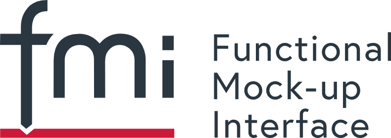
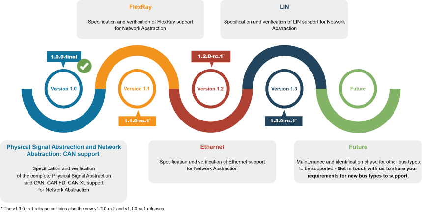



    



# Modelica Association Newsletter 2026-03

issued on <!-- TODO: issue date -->





    <i class="fa-regular fa-envelope" style="font-size:50px"></i>



## Letter from the Board

<!-- TODO: Letter from the Board -->



    <i class="fa-solid fa-building-columns" style="font-size:50px"></i>



## Modelica Association

<!-- TODO: news from the Modelica Association and its projects (FMI, SSP, DCP, eFMI, ...) -->

### FMI Project News

#### American Asian Modelica & FMI Conference 2026

The Asian and American Modelica and FMI Conference in September and October 2026 showed high international interest and usage of FMI in China / Asia and the Americas!

At the Asian Conference, FMI Project Leader Christian Bertsch gave an FMI beginners' tutorial (Material available on [GitHub](https://github.com/modelica/fmi-beginners-tutorial-2026)), and a Keynote "[15 Years Functional Mock-up Interface - a Journey from FMI 1.0 to 3.0 and the Road Ahead](https://fmi-standard.org/assets/literature/Asian_Modelica_and_FMI_Conference_2026/FMI_Keynote.pdf)" All the FMI related papers and presentations are listed on the [literature page](https://fmi-standard.org/literature/) of the FMI Project website.

At the American Conference, the FMI-LS-DAE working group presented their paper "[Towards an FMI Layered Standard for DAE: Applications for Simulation and Optimization](https://arxiv.org/abs/2606.22544)", which won the best paper award. Congratulations to the whole author team! 
All papers from the American Conference are available in the preliminary proceedings [on the conference website](https://modelica.org/events/american2026/).

#### News on FMI Layered Standards

##### FMI Layered Standard for Structured Data (FMI-LS-STRUCT) v1.0.0 Release

The FMI Project is happy to announce the release of the FMI Layered Standard for Structured Data (FMI-LS-STRUCT) v1.0.0.

This is the first release of the FMI Layered Standard for Structured Data (FMI-LS-STRUCT) on top of the FMI 3.0 Standard.

It is focused on the definition of sampled maps:
- Maps sampled on rectilinear grids
- Maps sampled on irregular grids
The specification of version 1.0.0 is published at https://fmi-standard.org/fmi-ls-struct/1.0.0/.

Many thanks to the whole development team, and especially to the Working Group Leader Klaus Schuch!

##### FMI Layered Standard for Network Communication (FMI-LS-BUS) Release Candidate v1.3.0-rc.1 

The FMI project is happy to announce the publication of a Release Candidate 1 of the FMI Layered Standard for Network Communication (FMI-LS-BUS) v1.3-rc.1!

This version includes the common Physical Signal Abstraction that fits for all bus types and the Network Abstraction that currently supports CAN, CAN FD, CAN XL, FlexRay, Ethernet, and LIN. Please note that v1.3.0-rc.1 release contains also the new v1.2.0-rc.1 and v1.1.0-rc.3.

Many thanks to the whole FMI-LS-BUS Working group (with members from Akkodis, Altair, AVL, Beckhoff Automation, Bosch, dSPACE, PMSF IT Consulting Pierre R. Mai, Siemens Digital Industries Software, tracetronic GmbH, Renault Group, and VECTOR Informatik) and especially to Benedikt Menne for the release work!

Learn more here: https://github.com/modelica/fmi-ls-bus/ and https://github.com/modelica/fmi-ls-bus/releases/tag/v1.3.0-rc.1

##### FMI-LS-BUS Presentation at HdT Software-in-the-Lopp 2026 Conference, Munich Dec 2/3 2026

Members of the FMI Project will present and demonstrate the latest development of FMI-LS-BUS at the Software-in-the-Lopp 2026 Conference by Haus-der-Technic in Munich December 2/3 2026. More information [here](https://www.hdt.de/software-in-the-loop-2026-vv00014/)

##### FMI-LS-BUS Web-Event 15.12.2026 15:00-17:00 CET

The FMI Project will present and demonstrate the latest development w.r.t. FMI-LS-BUS in an online event that is open to the public.

You can register for free here: https://www.linkedin.com/flagship-web/event/manage/7525648417478361090/

##### Pre-Release of FMI Layered Standard for Differential-Algebraic Equations (FMI-LS-DAE) v1.0.0-alpha.1

The FMI Project is happy to announce the first alpha pre-release of the FMI Layered Standard for Differential-Algebraic Equations (FMI-LS-DAE), which allows FMI 3.0 Model Exchange FMUs to expose their model equations as a semi-explicit index-1 system of differential-algebraic equations (DAE) instead of an ordinary differential equation (ODE) system.

Many thanks to the whole working group and especially to the working group leaders Andreas Heuermann (Santa Anna Research Institute) and Joel Andersson (FMIOPT)!

Summary: In addition to the continuous states of FMI 3.0 Model Exchange, this layered standard introduces algebraic variables and the corresponding residual equations, which are solved by the importer instead of inside the FMU. The additional information is described in the layered standard manifest file, which is part of the FMU archive, so that no extension of the FMI 3.0 C API is needed. A structural parameter declared by the FMU lets the importer switch between the classical ODE mode and the new DAE mode, which keeps such FMUs usable by importers that do not support this layered standard.

Key features:
*   A layered standard manifest stored inside the FMU at /extra/org.fmi-standard.fmi-ls-dae/fmi-ls-manifest.xml, defined by the XML schema fmi3LayeredStandardDaeManifest.xsd.
    Declaration of the algebraic variables and of the residual equations of the DAE in the manifest, together with the model structure and the dependencies of outputs, continuous state derivatives, event indicators and residuals. The dependency information preserves the sparsity of the DAE system, which is lost in the corresponding reduced ODE system.
*     A structural parameter enableDAEModeParameter that switches the FMU between ODE mode and DAE mode. An FMU implementing this layered standard is at the same time a valid FMI 3.0 Model Exchange ODE FMU and defaults to ODE mode, so that importers that do not support this layered standard can use it unchanged.
    No extension of the FMI 3.0 C API is required. Algebraic variables and residuals are exchanged through the existing FMI 3.0 getter and setter functions.

Exporting a model in DAE form addresses a number of long-standing issues:

*   Models can be exported without internal index reduction, which can improve accuracy through better handling of drift.
*    Local nonlinear solvers inside the FMU become unnecessary, avoiding mismatches between local and global error tolerances.
*    The sparsity of the original equation system is preserved instead of being lost during the reduction to an ODE, which allows importers to exploit sparsity for better performance.
*    The cost of the symbolic DAE-to-ODE transformation is avoided, which is particularly relevant for very large models, such as simulation models representing power grids on a national or larger scale.

For the full picture please check out the preprint of our paper “Towards an FMI Layered Standard for DAE: Applications for Simulation and Optimization” for the coming American Modelica and FMI Conference 2026 on arXiv: https://arxiv.org/abs/2606.22544 It also reports successful tests in the following tools: CasADi, Dymola, FMIOPT, fmusim, Simcenter Twin Activate, and MOO (the dynamic optimization tool of OpenModelica).

As an alpha pre-release, the specification is published for review and for prototype implementations, and it is still subject to change before the v1.0.0 release. Known limitations of this version are the restriction to semi-explicit index-1 DAEs, the consistent initialization in DAE mode, and the handling of discontinuities and events, which are not specified yet. Feedback from tool vendors and users is very welcome and is best provided as an issue in the FMI-LS-DAE GitHub repository.

You can inspect the specification of this pre-release here: https://modelica.github.io/fmi-ls-dae/v1.0.0-alpha.1/ and the current development version here: https://modelica.github.io/fmi-ls-dae/main/

For the general concept of Layered Standards to the FMI Standards see this paper: https://doi.org/10.3384/ecp204381

Learn more on the Release page on Github.

##### FMI Layered Standard WASM (FMI-LS-WASM) draft

In recent time Web Assembly (WASM) has attracted a lot of interest due to the full portability and memory safety through inherent sandboxing. These features are also particularly interesting for FMI.

A working group led by Pierre Mai (PMSF IT Conuslting) and Torsten Sommer (Dassault Systems) within the FMI Project has created a first prototype draft for Web Assembly support of in FMI in the form of a Layered Standard, based on the Functional Mock-up Interface 3.0 standard for the exchange of simulation models. It presents a mapping of the [FMI 3.0][FMI3] C API to the WebAssembly Component Model interface description language (WIT).

Note that this draft is being worked on actively, and thus is subject to change without notice.

The FMI 3.0 Layered Standard WebAssembly is currently maintained on GitHub and is published here: https://github.com/modelica/fmi-ls-wasm

Also included are examples show-casing the WIT definitions, using Rust, C and WAT implementations.

First prototypes are already in development and used to evaluate and benchmark the different concepts that are being discussed.

*This article is provided by the FMI Project*

<!-- END Modelica Association -->



    <i class="fa-solid fa-users" style="font-size:50px"></i>



## Conferences and user meetings

<!-- TODO: Conferences and user meetings -->

<!-- END Conferences and user meetings -->



    <i class="fa-solid fa-industry" style="font-size:50px"></i>



## Vendor news

<!-- TODO: Vendor news -->

<!-- END Vendor news -->



    <i class="fa-solid fa-book" style="font-size:50px"></i>



## News from libraries

<!-- TODO: News from libraries -->

<!-- END News from libraries -->



    <i class="fa-solid fa-graduation-cap" style="font-size:50px"></i>



## Education news

<!-- TODO: Education news -->

<!-- END Education news -->
