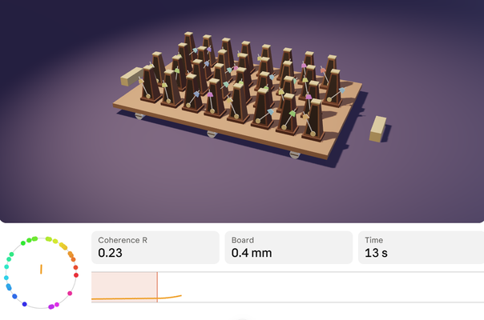
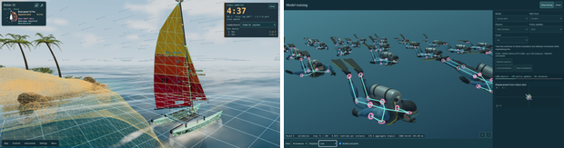



    



# Modelica Association Newsletter 2026-03

issued on <!-- TODO: issue date -->





    <i class="fa-regular fa-envelope" style="font-size:50px"></i>



## Letter from the Board

<!-- TODO: Letter from the Board -->



    <i class="fa-solid fa-building-columns" style="font-size:50px"></i>



## Modelica Association

<!-- TODO: news from the Modelica Association and its projects (FMI, SSP, DCP, eFMI, ...) -->

<!-- END Modelica Association -->



    <i class="fa-solid fa-users" style="font-size:50px"></i>



## Conferences and user meetings

<!-- TODO: Conferences and user meetings -->

<!-- END Conferences and user meetings -->



    <i class="fa-solid fa-industry" style="font-size:50px"></i>



## Vendor news

<!-- TODO: Vendor news -->

### Rumoca 0.11 and user group meeting

[Rumoca](https://github.com/cognipilot/rumoca) is an open-source (Apache-2.0) Modelica compiler written in Rust. It compiles Modelica packages into explicit intermediate forms (flat model, DAE, solve-ready IR) for simulation or export to C, CasADi, JAX and FMI. Version 0.11.0 was released on 28 November 2026. Every change is checked in CI against the Modelica Standard Library examples, comparing trajectories with OpenModelica references.

On 18 November 2026, users and developers met at Purdue University for a Rumoca user group meeting with live demos, a roadmap discussion and hands-on hacking. The winning user submission, a swarm of metronomes simulated with Rumoca, is shown below.

Source: [https://github.com/cognipilot/rumoca](https://github.com/cognipilot/rumoca). Rumoca is available from [PyPI](https://pypi.org/project/rumoca/), [npm](https://www.npmjs.com/package/@cognipilot/rumoca) and [in the browser](https://cognipilot.github.io/rumoca/).

*This article is provided by James Goppert (Purdue University)*

<!-- END Vendor news -->



    <i class="fa-solid fa-book" style="font-size:50px"></i>



## News from libraries

<!-- TODO: News from libraries -->

### MultiBodyLie and Collision libraries, demonstrated in Ocean Web

CogniPilot modelica_models ([https://github.com/CogniPilot/modelica_models/](https://github.com/CogniPilot/modelica_models/)) is an open-source collection of Modelica libraries. It includes MultiBodyLie, a rigid-body dynamics library, and the new Collision library for contact between plane, sphere, capsule and box shapes.

Both libraries are used in [Ocean Web](https://github.com/CogniPilot/ocean_web), an open-source, browser-based ocean robotics research prototype built on Modelica models compiled by Rumoca to FMI 3. It models sails as cloth and simulates sailboats, submarines, drones, a scuba diver and marine animals in one scene.

Control policies can be trained with reinforcement learning on many model instances in parallel, as shown below (right) for the scuba diver. Ship hydrodynamics are compared with benchmark measurements from the IIHR Wave Basin and Towing Tank at the University of Iowa ([https://iihr.uiowa.edu/facilities-and-resources/wave-basin-and-towing-tank](https://iihr.uiowa.edu/facilities-and-resources/wave-basin-and-towing-tank)), whose published study was very helpful for this work.

Live demo: [https://cognipilot.github.io/ocean_web/](https://cognipilot.github.io/ocean_web/) · Source: [https://github.com/CogniPilot/ocean_web](https://github.com/CogniPilot/ocean_web)

*This article is provided by James Goppert (Purdue University)*

<!-- END News from libraries -->



    <i class="fa-solid fa-graduation-cap" style="font-size:50px"></i>



## Education news

<!-- TODO: Education news -->

<!-- END Education news -->
