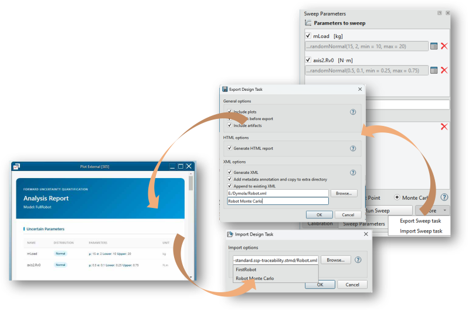
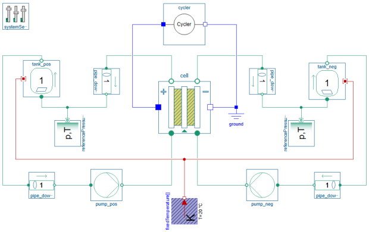
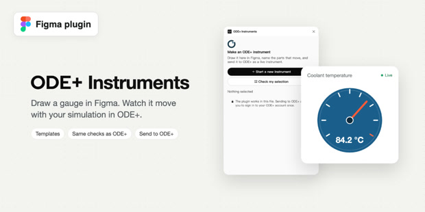
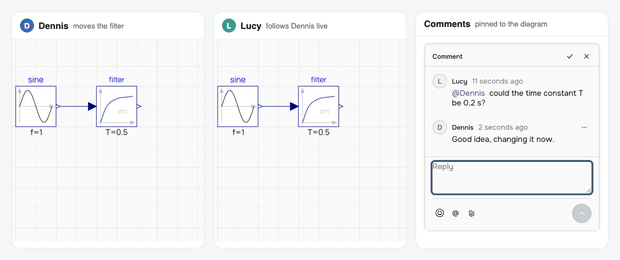
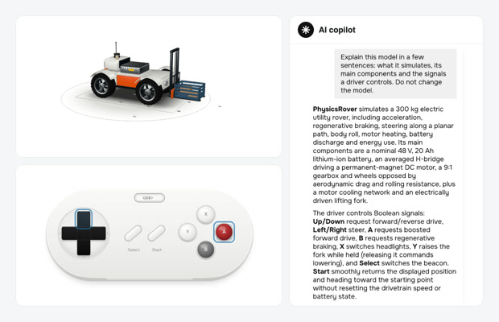
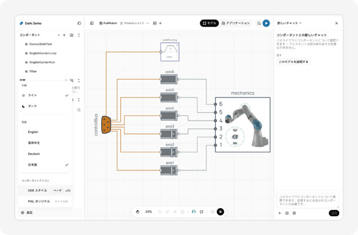
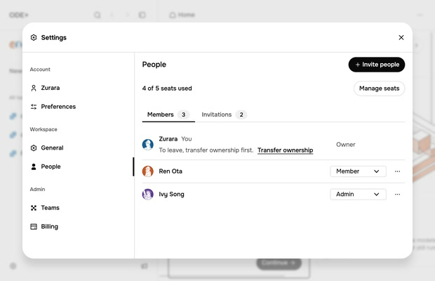



    



# Modelica Association Newsletter 2026-03

issued on <!-- TODO: issue date -->





    <i class="fa-regular fa-envelope" style="font-size:50px"></i>



## Letter from the Board

Dear Modelica, FMI, SSP, DCP, eFMI interested,

With the year coming to its closure, we can look back at a quite eventful 2026. Our two regional conferences had a combined record number of submissions and attendees. The proceedings are already available for both the [American](https://modelica.org/events/american2026/#proceedings) and the [Asian conference](https://ecp.ep.liu.se/index.php/modelica/issue/view/116). Beyond these two official events, I am very glad about the many other activities supporting our community - whether this be the [EOOLT Workshop](https://eoolt.org/2026/index.html), [ThermoSim](https://tlk-energy.de/events/thermosim-2026) for the German-speaking community, or all the activities of our organizational members. 

In retrospect, we can probably say that 2026 was the year when AI learned Modelica. Many successful endeavors were already underway in the years before, but the noticeable jump in general usability (both in frontier models and in open-source models) led now to much more widespread adoption.

What certainly helps this adoption is the openness of our standards. It has turned out to be a very wise decision to base Modelica entirely on text; the FMI standard (and all our other standards) also builds on well-established formats, which makes their integration into agentic workflows quite easy. After all, also AI agents share the same basic problems as humans do: they need to be able to communicate with each other and process each others work.

We have noticed an uptick in tools that support our standards. The growth of FMI ([298 tools](https://fmi-standard.org/tools/) and counting) is truly unstoppable, and [new Modelica tools](https://modelica.org/tools/) have also entered the field, both commercial and free. After a period of stability, this is a welcome revival.

Existing tools continue to improve at a high rate as well. A major contributor to this development is the [ITEA OpenScaling Project](https://openscaling.org/) led by Oliver Lenord. The simulation of large models could be improved in many cases by orders of magnitude. Furthermore, support for uncertainty quantification and credible simulation frameworks grew substantially. It would be wrong to attribute this progress to AI. It was the joint effort of many international researchers and developers. 

Whereas computer science and especially mathematics offer a closed feedback loop for AI agents, the situation is different for engineering. Here the feedback loop cannot yet be fully closed. The latency until we know whether something really works may be substantial, and failures are potentially hazardous. Practical experience is therefore much more central to our field, and especially near production there is so much intrinsic knowledge that has not been written down. As such, I expect we will still have a longer period of collaboration between human engineers and supporting AI agents.

How will these collaborations form? How much modeling will we still do ourselves, and how can we best integrate simulation into productive agentic workflows? Such questions will be addressed at our next major event: the [17th International Modelica Conference](https://modelica.org/events/modelica2027/) in Prague, Czech Republic. It will take place on **September 20-22**, and the first important deadline is the **submission of Scientific Papers on April 19**, 2027. 

Please note that we will provide awards for the best papers and that you can also participate for our library award. [Sponsors](https://modelica.org/events/modelica2027/#sponsors--call-for-sponsors) for this event are of course also highly welcome.

Naturally we expect that AI will be one of the major topics, but Modelica and FMI are multi-domain tools, and this conference has always been a great place for cross-fertilization between experts of different backgrounds. It is a place where application engineers can meet the tool developers, where a healthy mixture of industry and academia is present, and where people from automotive, aerospace, and energy can discuss their common problems.

In this spirit, my Christmas wish is that many of you are going to surprise me with your contribution!

Have a wonderful advent season!

Dirk Zimmer on Novemeber 26, 2026 \
*Chair of the Modelica Association*



    <i class="fa-solid fa-building-columns" style="font-size:50px"></i>



## Modelica Association

<!-- TODO: news from the Modelica Association and its projects (FMI, SSP, DCP, eFMI, ...) -->

### FMI Project News

#### American Asian Modelica & FMI Conference 2026

The Asian and American Modelica and FMI Conference in September and October 2026 showed high international interest and usage of FMI in China / Asia and the Americas!

At the Asian Conference, FMI Project Leader Christian Bertsch gave an FMI beginners' tutorial (Material available on [GitHub](https://github.com/modelica/fmi-beginners-tutorial-2026)), and a Keynote "[15 Years Functional Mock-up Interface - a Journey from FMI 1.0 to 3.0 and the Road Ahead](https://fmi-standard.org/assets/literature/Asian_Modelica_and_FMI_Conference_2026/FMI_Keynote.pdf)" All the FMI related papers and presentations are listed on the [literature page](https://fmi-standard.org/literature/) of the FMI Project website.

At the American Conference, the FMI-LS-DAE working group presented their paper "[Towards an FMI Layered Standard for DAE: Applications for Simulation and Optimization](https://arxiv.org/abs/2606.22544)", which won the best paper award. Congratulations to the whole author team! 
All papers from the American Conference are available in the preliminary proceedings [on the conference website](https://modelica.org/events/american2026/).

#### News on FMI Layered Standards

##### FMI Layered Standard for Structured Data (FMI-LS-STRUCT) v1.0.0 Release

The FMI Project is happy to announce the release of the FMI Layered Standard for Structured Data (FMI-LS-STRUCT) v1.0.0.

This is the first release of the FMI Layered Standard for Structured Data (FMI-LS-STRUCT) on top of the FMI 3.0 Standard.

It is focused on the definition of sampled maps:
- Maps sampled on rectilinear grids
- Maps sampled on irregular grids
The specification of version 1.0.0 is published at https://fmi-standard.org/fmi-ls-struct/1.0.0/.

Many thanks to the whole development team, and especially to the Working Group Leader Klaus Schuch!

##### FMI Layered Standard for Network Communication (FMI-LS-BUS) Release Candidate v1.3.0-rc.1 

The FMI project is happy to announce the publication of a Release Candidate 1 of the FMI Layered Standard for Network Communication (FMI-LS-BUS) v1.3.0-rc.1!

This version includes the common Physical Signal Abstraction that fits for all bus types and the Network Abstraction that currently supports CAN, CAN FD, CAN XL, FlexRay, Ethernet, and LIN. Please note that v1.3.0-rc.1 release contains also the new v1.2.0-rc.1 and v1.1.0-rc.3.

Many thanks to the whole FMI-LS-BUS Working group (with members from Akkodis, Altair, AVL, Beckhoff Automation, Bosch, dSPACE, PMSF IT Consulting Pierre R. Mai, Siemens Digital Industries Software, tracetronic GmbH, Renault Group, and VECTOR Informatik) and especially to Benedikt Menne for the release work!

Learn more here: https://github.com/modelica/fmi-ls-bus/ and https://github.com/modelica/fmi-ls-bus/releases/tag/v1.3.0-rc.1

##### FMI-LS-BUS Presentation at HdT Software-in-the-Lopp 2026 Conference, Munich Dec 2/3 2026

Members of the FMI Project will present and demonstrate the latest development of FMI-LS-BUS at the Software-in-the-Lopp 2026 Conference by Haus-der-Technic in Munich December 2/3 2026. More information [here](https://www.hdt.de/software-in-the-loop-2026-vv00014/)

##### FMI-LS-BUS Web-Event 15.12.2026 15:00-17:00 CET

The FMI Project will present and demonstrate the latest development w.r.t. FMI-LS-BUS in an online event that is open to the public.

You can register for free here: https://www.linkedin.com/events/7525648417478361090/

##### Pre-Release of FMI Layered Standard for Differential-Algebraic Equations (FMI-LS-DAE) v1.0.0-alpha.1

The FMI Project is happy to announce the first alpha pre-release of the FMI Layered Standard for Differential-Algebraic Equations (FMI-LS-DAE), which allows FMI 3.0 Model Exchange FMUs to expose their model equations as a semi-explicit index-1 system of differential-algebraic equations (DAE) instead of an ordinary differential equation (ODE) system.

Many thanks to the whole working group and especially to the working group leaders Andreas Heuermann (Santa Anna Research Institute) and Joel Andersson (FMIOPT)!

Summary: In addition to the continuous states of FMI 3.0 Model Exchange, this layered standard introduces algebraic variables and the corresponding residual equations, which are solved by the importer instead of inside the FMU. The additional information is described in the layered standard manifest file, which is part of the FMU archive, so that no extension of the FMI 3.0 C API is needed. A structural parameter declared by the FMU lets the importer switch between the classical ODE mode and the new DAE mode, which keeps such FMUs usable by importers that do not support this layered standard.

Key features:
*   A layered standard manifest stored inside the FMU at /extra/org.fmi-standard.fmi-ls-dae/fmi-ls-manifest.xml, defined by the XML schema fmi3LayeredStandardDaeManifest.xsd.
    Declaration of the algebraic variables and of the residual equations of the DAE in the manifest, together with the model structure and the dependencies of outputs, continuous state derivatives, event indicators and residuals. The dependency information preserves the sparsity of the DAE system, which is lost in the corresponding reduced ODE system.
*     A structural parameter enableDAEModeParameter that switches the FMU between ODE mode and DAE mode. An FMU implementing this layered standard is at the same time a valid FMI 3.0 Model Exchange ODE FMU and defaults to ODE mode, so that importers that do not support this layered standard can use it unchanged.
    No extension of the FMI 3.0 C API is required. Algebraic variables and residuals are exchanged through the existing FMI 3.0 getter and setter functions.

Exporting a model in DAE form addresses a number of long-standing issues:

*   Models can be exported without internal index reduction, which can improve accuracy through better handling of drift.
*    Local nonlinear solvers inside the FMU become unnecessary, avoiding mismatches between local and global error tolerances.
*    The sparsity of the original equation system is preserved instead of being lost during the reduction to an ODE, which allows importers to exploit sparsity for better performance.
*    The cost of the symbolic DAE-to-ODE transformation is avoided, which is particularly relevant for very large models, such as simulation models representing power grids on a national or larger scale.

For the full picture please check out the preprint of our paper “Towards an FMI Layered Standard for DAE: Applications for Simulation and Optimization”, presented at the American Modelica and FMI Conference 2026, on arXiv: https://arxiv.org/abs/2606.22544. It also reports successful tests in the following tools: CasADi, Dymola, FMIOPT, fmusim, Simcenter Twin Activate, and MOO (the dynamic optimization tool of OpenModelica).

As an alpha pre-release, the specification is published for review and for prototype implementations, and it is still subject to change before the v1.0.0 release. Known limitations of this version are the restriction to semi-explicit index-1 DAEs, the consistent initialization in DAE mode, and the handling of discontinuities and events, which are not specified yet. Feedback from tool vendors and users is very welcome and is best provided as an issue in the FMI-LS-DAE GitHub repository.

You can inspect the specification of this pre-release here: https://modelica.github.io/fmi-ls-dae/v1.0.0-alpha.1/ and the current development version here: https://modelica.github.io/fmi-ls-dae/main/

For the general concept of Layered Standards to the FMI Standards see this paper: https://doi.org/10.3384/ecp204381

Learn more on the Release page on Github.

##### FMI Layered Standard WASM (FMI-LS-WASM) draft

In recent time Web Assembly (WASM) has attracted a lot of interest due to the full portability and memory safety through inherent sandboxing. These features are also particularly interesting for FMI.

A working group led by Pierre Mai (PMSF IT Conuslting) and Torsten Sommer (Dassault Systems) within the FMI Project has created a first prototype draft for Web Assembly support of in FMI in the form of a Layered Standard, based on the Functional Mock-up Interface 3.0 standard for the exchange of simulation models. It presents a mapping of the FMI 3.0 C API to the WebAssembly Component Model interface description language (WIT).

Note that this draft is being worked on actively, and thus is subject to change without notice.

The FMI 3.0 Layered Standard WebAssembly is currently maintained on GitHub and is published here: https://github.com/modelica/fmi-ls-wasm

Also included are examples show-casing the WIT definitions, using Rust, C and WAT implementations.

First prototypes are already in development and used to evaluate and benchmark the different concepts that are being discussed.

*This article is provided by the FMI Project*

### eFMI® Project News

#### eFMI® Standard 1.0.0 Beta 2 released

The next [candidate-draft](https://www.efmi-standard.org/standard/#release-cycle-and-versioning), the *eFMI® Standard 1.0.0 Beta 2*, for the first official release of the *eFMI® Standard* has been released! You can download it from the [eFMI home page](https://www.efmi-standard.org/).

This is the second Beta release, continuing the chapter-wise finalization of the *eFMI® Standard 1.0.0*. This time *"Chapter 3. Guarded Language for Embedded Control (GALEC)"* is finalized (Beta 1 finalized *"Chapter 5. Behavioral Model Representation"*).

The GALEC specification has been significantly extended and refined to achieve semantic completeness; the main features of the GALEC specification are:

 - Complete well-formedness and execution semantic rules, whose main concepts are formally defined and mandatory analyses backed by constructive definitions (e.g., graph-based pseudoalgorithms).
 - Clear requirements, avoiding optional feature levels, essentially distinguishing only "must" and "must not".
 - Clear separation between normative rules and non-normative examples and rationales. The latter provide a comprehensive overview of language design choices, their consequences, and potential optimizations and design-alternatives for compliant tooling.
 - Guarantees on program side-effects, maximum algorithmic operations (i.e., termination) and memory consumption, safe indexing, and strict error-handling. GALEC programs are deterministic and well-defined without undefined behavior.
 - Advanced control- and data-flow rules guaranteeing proper initialization and state usage.
 - Error signaling concept part of ordinary control-flow (no exceptions) enabling delayed error-handling without the risk of missing numerical issues, even if such only occur within a subexpression whose result is not assigned.
 - Simple name space and scoping concept without shadowing.
 - Explicit operators and functions; no implicit type conversions or operator or function overloading.
 - Dedicated multi-dimensional arithmetic operators for all kinds of multidimensional and scalar operands combinations.
 - Definition of commutable statements enabling target specific concurrent execution.
 - Rich set of built-in functions for typical mathematical operations (such as solving linear equation systems or interpolation) and to abstract from target environment specific characteristics (such as type ranges), properly integrated with the error handling concepts.
 - Online recalibration and input-dependent (re)initialization with well-defined levels of variabilities.
 - Well-defined block-interface and life-cycle, defining how to utilize (i.e., system-integrate) GALEC programs.

In addition to *"Chapter 3. Guarded Language for Embedded Control (GALEC)"*, Beta 2 introduces proper syntax highlighting for listings, in particular GALEC programs, and finalizes all appendices:

 - *"Appendix A: Implementation of GALEC built-in functions"*: Portable reference implementation of the GALEC built-in functions, except `solveLinearEquations` and `interpolation1/2/3D`, in GALEC with target platform specific semantic (like type ranges) highlighted as embedded pseudocode fragments.
 - *"Appendix B: Legal information"*: Copyright, licensing, registered trademarks, colophon (fonts and tooling used to write the standard), and disclaimer.
 - *"Appendix C: Normative references"*: Precise definition of referenced standards, including revisions, corrigenda, errata, amendments, etc.

There are only minor improvements in the other chapters; they will be focused on and finalized in individual future Beta candidate-drafts.

If you have any general questions, feedback or improvement proposals for the *eFMI® Standard*, please follow the [reporting specification issues and new feature requests guidelines on our website](https://www.efmi-standard.org/standard/#reporting-specification-issues-and-new-feature-requests) or contact us on our public mailing list, [`efmi-info@googlegroups.com`](https://groups.google.com/g/efmi-info) (no Google account required).

**Your feedback is very welcome!**

#### eFMUs on STM32®/ARM® Cortex-M® microcontrollers

_**Top left & bottom right:** Modelica model & derived eFMI STM32 firmware in Dymola & STM32CubeIDE; **Bottom left & top right:** MiL simulation of CHiL setup & actual measurements in Digilent WaveForms._

A new [open source repository on GitHub](https://github.com/ALSETLab/efmi-pss-use-case) provides a general template workflow for system integration of eFMUs on STM32®/ARM® Cortex-M® microcontrollers. The application for power system stabilizers has been presented at the [American Modelica & FMI Conference 2026](https://modelica.org/events/american2026/) in the paper *"Real-time Simulation and CHiL Testing of Power System Stabilizers on Microcontrollers with Modelica and eFMI"* (see the linked repository for details).

The demonstrated workflow considers all tasks of going from a Modelica model to safety-critical, hard real-time microcontroller execution: MiL, SiL & HiL testing; MISRA C:2023 and SEI CERT C Coding Standard compliance; Pin, clock, and timer setup; Integration of eFMU production code with STM32®/ARM® Cortex-M® hardware abstraction layer (HAL) code; systematic error detection (e.g., overruns, error signals, etc).

*This article is provided by Christoff Bürger ([Dassault Systèmes](https://www.3ds.com/), Christoff.Buerger@3ds.com)*
<!-- END Modelica Association -->



    <i class="fa-solid fa-users" style="font-size:50px"></i>



## Conferences and user meetings

<!-- TODO: Conferences and user meetings -->
### Modelon Innovate 2027

**Physics-Driven. Agent-Powered.**\
**April 21-22, 2027 | Clarion Malmö Live | Malmö, Sweden**

Modelon Innovate brings together Modelon customers, partners, and industry experts for two in-person days of insight, education, and connection.

The event agenda is now taking shape, with [keynote speakers and featured sessions](https://www.modelon.com/https://www.modelon.com/innovate-2027/speakers/) starting to be announced. Attendees can look forward to customer success stories, industry-focused presentations, partner perspectives, product updates, and discussions exploring the future of simulation and AI-enabled engineering.

Participants will also gain practical knowledge through hands-on training led by Modelon experts, with sessions focused on Modelon Impact workflows, Modelica-based skills, troubleshooting, and applying new capabilities to real-world engineering challenges.

Explore the growing agenda and secure your spot on the [Modelon Innovate website.](https://www.modelon.com/innovate-2027/) 

*This article is provided by Lauren Caris at Modelon.*

### American Modelica & FMI Conference 2026: a report from Atlanta

*Participants of the OpenModelica Workshop.*

The **American Modelica & FMI Conference 2026** brought our community together at Georgia Tech in Atlanta on October 12–14. Organized by NAMUG with the Modelica Association, it featured six workshops, two keynotes, 27 paper presentations, and eight industrial presentations.

The conference featured two keynotes. In the first, Oliver Lenord (Bosch) explored how open standards enable larger, faster, and more credible simulations. The second keynote, by Daniel Mikkelson (Idaho National Laboratory), addressed nuclear-system modeling for integrated energy systems. Technical sessions ranged from FMI and emerging tools to buildings, power systems, automotive applications, and data centers. A new track broadened the discussion to equation-oriented languages beyond Modelica.

Congratulations to Elmir Nahodovic and coauthors for the Best Paper, “Towards an FMI Layered Standard for DAE,” and to Md Nazmul Hassan Chowdhury and Luigi Vanfretti for the Best Student Paper, “MMChvdcLibrary.”

Thank you to our hosts, presenters, workshop organizers, reviewers, and sponsors. [Presentation slides](/events/american2026/presentations/) and [conference highlights and photos](american2026-recap/) are available. Final proceedings will be published by Linköping University Electronic Press.

*This article is provided by Luigi Vanfretti ([Rensselaer Polytechnic Institute](https://www.rpi.edu/)).*

<!-- END Conferences and user meetings -->



    <i class="fa-solid fa-industry" style="font-size:50px"></i>



## Vendor news

<!-- TODO: Vendor news -->

### New Agentic AI Capabilities in Modelon Impact Expand Access to Physics-Based Simulation

Modelon recently introduced new agentic AI capabilities in **Modelon Impact** designed to make physics-based modeling and simulation more accessible, productive, and easier to use. A built-in AI Agent works directly within the simulation environment, helping users create and modify models, troubleshoot issues, set up experiments, run simulations, analyze results, and generate visualizations using natural-language prompts. Rather than simply answering questions, the agent actively participates in engineering workflows, helping users complete simulation tasks faster and with less manual effort.
To demonstrate these capabilities, Modelon released a video showing the AI Agent in action inside Modelon Impact, where it guides model development, resolves modeling challenges, and assists with simulation and post-processing tasks.

Modelon also introduced the **Modelon AI Connector**, which enables external AI agents to interact with Modelon Impact through the Model Context Protocol (MCP). A second video demonstrates how AI agents can access validated Modelica-based models, execute simulations, and incorporate physics-based results into broader engineering workflows and decision-making processes.
 
Together, these capabilities represent an important step toward combining generative AI with high-fidelity, Modelica-based simulation to support faster and more informed engineering decisions. [Learn more and watch the videos.](https://www.modelon.com/blog/physics-for-every-engineer-key-takeaways-from-modelons-capital-markets-day-2026/)

### Modelon and SimetrixDT Expand Access to Data Center Simulation in Australia and New Zealand

Modelon has entered a value-added reseller agreement with [Simetrix Digital Technologies](https://www.simetrixdt.com/) (SimetrixDT) to expand access to advanced system simulation solutions for the rapidly growing data center market in Australia and New Zealand. As AI adoption drives increased power densities and greater demands on cooling, energy efficiency, and reliability, simulation is playing an increasingly important role in data center design and operations. 

Through the [partnership](https://www.modelon.com/blog/modelon-and-simetrixdt-expand-access-to-data-center-simulation-in-australia-and-new-zealand/), SimetrixDT will offer Modelon’s simulation portfolio, including Modelon Impact and the [Modelon Data Center Library](https://www.modelon.com/blog/introducing-the-data-center-library-for-modelon-impact/), which provides validated Modelica-based models for data center cooling, thermal management, and infrastructure systems. The library enables engineering teams to evaluate designs, optimize performance, test control strategies, and support digital twin workflows throughout the facility lifecycle.

*This article is provided by Lauren Caris, [Modelon](https://modelon.com/)*

### Dymola 2027x

We are pleased to announce that Dymola 2027x has been released on Friday, 27 November 2026.
Summary of key features:

**Model development and Simulation**
- Enhanced simulation summary report
- FMI enhancements – including support for FMI-LS-DAE

**Model experimentation**
- Uncertainty Quantification and credibility using SSP layered standard

**Other**
- Library enhancements - including new Redox Flow Battery Library
- eFMI support for STM32 / Arm Cortex-M micro-controller eco-system
- Support for Modelica Language Specification version 3.7

See [latest release](https://www.3ds.com/products/catia/dymola/latest-release) for more details.

*This article is provided by Dan Henriksson ([Dassault Systèmes](https://www.3ds.com/products/catia/dymola))*

### Dymola Redox Flow Battery Library

With the release of Dymola 2027x, we introduce the **Redox Flow Battery Library** for the dynamic simulation of redox flow battery (RFB) systems.

The library covers the complete system hierarchy, from electrochemical cells and stacks to system-level components such as tanks, pumps, pipes, and valves. Its modular architecture allows users to select and combine different model formulations according to their application, balancing model detail and computational efficiency.

Electrochemical models account for local ion concentrations and different formulations of activation and concentration overpotentials. Configurable electrolyte media provide concentration-dependent thermodynamic, transport, and electrochemical properties. Ready-to-use media for vanadium- and iron-based electrolytes are included, while the framework also supports the implementation and investigation of other electrolyte formulations and multiple redox couples. Both scaled and spatially discretized stack models are available, including the representation of shunt currents and their effects on battery operation.

The library supports a range of applications, from cell and stack design and optimization to system performance analysis and the development of control strategies.

*This article is provided by Claas Heckel ([Dassault Systèmes Deutschland GmbH](https://www.3ds.com/))*

**Xcelerate26: SimulationX User Event Explores AI-Enhanced Engineering Workflows**
The SimulationX user community met on 11 November 2026 at Keysight Technologies in Böblingen, Germany, for [Xcelerate26](https://www.xpincorporated.com/xcelerate26), a user event organized with XPI. The event brought together SimulationX users, partners and engineering experts to exchange experiences, explore application developments and discuss the future direction of system simulation.

A key contribution from Keysight Technologies was the session SimulationX 2026 – New Features and Development Roadmap, which presented recent platform enhancements and provided an outlook on the planned developments for SimulationX 2027. Particular attention was given to the integration of Artificial Intelligence into engineering workflows.

The SimulationX 2027 outlook introduces an AI-assisted approach built around a Model Context Protocol (MCP) server, enabling external AI agents to interact with SimulationX through its COM interface. The planned capabilities include an integrated AI assistant, inline assistance within the modelling environment, and support for engineering tasks such as model interpretation, parameter insights, result comparison and study preparation. The approach also considers organization-approved AI providers, allowing users to work within their established AI environments.

These developments reflect an evolving direction for Modelica-based engineering tools: combining established physical modelling and simulation capabilities with AI-assisted interaction and analysis, while keeping engineers in control of their models and engineering decisions.

[Click here](https://lnkd.in/p/dpfyaVxM) to view some pictures from the event. 

_This article is provided by Majid Aziz ([Keysight](https://www.keysight.com/))_

### TECHNIA releases an MCP server for Dymola

TECHNIA has released the first version of its MCP server for Dymola. Any AI assistant that supports the Model Context Protocol (MCP) can now work directly in your local Dymola installation, alongside your existing libraries and licence.

#### Key features

- **Libraries and models:** load libraries, extend the MODELICAPATH, read class text and dependencies, modify and save models.
- **Build and simulate:** create, check, debug and translate models, set experiment settings and parameters, simulate, linearise, create and run `.mos` scripts, export FMUs.
- **Results:** open result files, read signals, extract initial and final values, apply signal operators, create and export plots.
- **Session handling:** start and stop Dymola, choose between installed versions, clean up orphaned sessions, return error logs.
- **Data under your control:** the server runs locally with the AI model you choose, including one on your own hardware, so your AI policy, not a vendor's, governs your IP.
- **Works with existing tools:** it adds to any MCP servers you already use rather than replacing them.

Contact [David Briant](mailto:david.briant@technia.com) or visit the [TECHNIA Dymola MCP page](https://www.technia.com/en/mbse/software/dymola-mcp-server/) for a demonstration or trial.

*This article is provided by David Briant (TECHNIA)*

### OpenModelica 1.28.0 in Preparation

The next [OpenModelica](https://openmodelica.org/) release, 1.28.0, is in preparation. Its highlights:

* **OpenModelica in the web browser** with nothing to install: OMEdit (with an optional AI assistant), OMShell, OMNotebook, OMPlot and a simulator with 3D animation, all compiled to WebAssembly and run locally in the browser.
* **FMI 3.0 export and import**: OpenModelica exports FMI 3.0 FMUs for Model Exchange and Co-Simulation, and OpenModelica and OMSimulator import them.
* **Modelica 3.7** support in the frontend (`--std=3.7`), for example unitful literals and `nthRoot`.
* **OMEdit**: Figure and Plot annotations, an array parameter editor, dark mode, UML class diagrams and Modelica Language Server integration.
* **Simulation**: the solver is now chosen automatically by default (`-s=auto`), with CVODE replacing DASSL as its choice for most models, simulations free their memory through reference counting instead of a garbage collector, and the new backend supports resizable arrays.

OpenModelica developers take part in the FMI-LS-DAE and FMI-LS-WASM working groups, and 1.28.0 contains first prototypes of both layered standards. Models in DAE mode can be exported following the FMI-LS-DAE v1.0.0-alpha.1 draft, and OMSimulator can import them. FMUs can also be exported with a WebAssembly binary, optionally alongside native binaries for Linux, macOS and Windows, following the early FMI-LS-WASM draft, which is still being worked on and may change without notice.

You can try this now on the [OpenModelica web playground](https://playground.openmodelica.org/demo/). For example, open the [district heating example in DAE mode](https://playground.openmodelica.org/demo/simulator/index.html?id=districtheating), simulate it and export it as an FMU.



<em>FMU export dialog of the OpenModelica web playground with FMI-LS-DAE and FMI-LS-WASM export</em>



*This article is provided by Andreas Heuermann for the [OpenModelica](https://openmodelica.org/) project*

### [ODE+](https://www.ode.plus): Buildings Library 14 in the browser, a new look for the MSL and interactive simulation in beta

In addition to the features described in the [previous issue](https://modelica.org/newsletter/2026-02/), [ODE+](https://www.ode.plus) Component has added the following since August. Details and short videos are in the [ODE+ changelog](https://www.ode.plus/en/changelog).

#### Buildings Library 14, compiled in the browser

Models that call external C functions are now compiled to WebAssembly and simulated in the browser, with the library's C sources built next to the model. 556 of the 614 examples of the Buildings Library 14.0.0 (91%, up from 69% with Buildings 13) and 211 of the 216 examples of ThermofluidStream 1.4.1 run on the user's own machine, without waiting for a server. Weather files and CSV output are handled in the browser; models coupled to EnergyPlus, Python, FFD or BCVTB still run on the server.

#### A new design system for the MSL icons

The Modelica Standard Library icons were drawn over many years by many authors, without a shared color design. ODE+ now offers an optional redesign: one color system with consistent saturation across physical domains, the hues users already know, and a light and a dark variant of every color, so large diagrams stay readable in both modes. 107 fluid and thermal icons were redrawn in the same style. Only the display changes; the Modelica code is not modified, and the original look is one setting away.

#### Modelica simulation goes live

Besides a single run, ODE+ now runs a model many times for a parameter study. A parameter sweep shows every run in one chart, and MultiBody results replay in 3D next to their charts on one shared timeline.

Interactive simulation is in closed beta and coming soon to all users. Modelica models are compiled to a WebAssembly FMU and run live in the browser, paused and resumed, and parameters can be tuned while the model runs. Knobs, sliders, gauges, lamps and a four-channel scope on the diagram are linked to model variables and respond during the run, and they can be operated by touch, keyboard or a gamepad.

#### Custom 2D interactive instruments from Figma

Also part of the closed beta, the ODE+ Figma plugin turns a control or display drawn in Figma into a live instrument. The plugin checks the design, names its moving parts and ports, and sends it to the user's ODE+ account, where it is linked to model variables like a built-in instrument.

#### Endless 3D assets for interactive simulation, from the community and your own CAD

In the same beta, a 3D Model instrument imports public Onshape assemblies and robots from MuJoCo Menagerie and ROS packages (URDF, xacro), or the user's own CAD exported as glTF, OpenUSD or URDF. Each part is linked to a model variable, so the imported model moves with the simulation. Built-in 3D devices such as pumps, valves, tanks, motors and heat exchangers show the state of a plant model.

#### Working together

A task is shared with a link. In a shared task, team members can follow each other live and see the other person's cursor and edits. Comments are pinned to the diagram, with mentions and replies, and resolved when done.

#### AI copilot and MCP server

The assistant in the side panel reads the open model and answers questions about it, builds or changes a model from a description, and can be asked to fix a failed run from its result card. The generated Modelica code stays visible and editable.

The ODE+ MCP server, which lets external AI clients use ODE+, has been renewed. Clients now sign in with OAuth instead of a token in the URL, connect over Streamable HTTP as well as SSE, and get a closed loop of tools: create and list tasks, write and read a model, check it, simulate it with parameter overrides, read the run's results, and open the task in ODE+. Setup instructions for Claude, Codex, Cursor and other clients are in the [ODE Modelica MCP Server repository](https://github.com/Orthogonalpub/modelica_simulation_mcp_server).

#### iPad and touch

The whole workflow, from building a model to reading its results, works on an iPad with a finger or Apple Pencil and without a keyboard. Touch targets follow Apple's Human Interface Guidelines, and a magnifier under the finger makes small ports easy to hit.

#### Four languages

The interface is available in English, Chinese, German and Japanese and switches without reloading the page.

#### Free for teaching

Teachers and students at universities worldwide can use ODE+ free of charge during their courses. In the winter semester 2026/27, the Technical University of Munich (TUM) is again using ODE+ in its Modelica teaching.

#### Coming next

A Team plan for organizations, building on the team spaces described in the previous issue.

Questions and feedback are welcome at [contact@ode.plus](mailto:contact@ode.plus).

*This article is provided by Dr. Yang Ji ([orthogonal GmbH](https://www.ode.plus))*

<!-- END Vendor news -->



    <i class="fa-solid fa-book" style="font-size:50px"></i>



## News from libraries

<!-- TODO: News from libraries -->

<!-- END News from libraries -->



    <i class="fa-solid fa-graduation-cap" style="font-size:50px"></i>



## Education news

### Educational Video Tutorial series on Multi-Domain System Modeling

A new series of video tutorials focused on multi-domain physical system modeling and simulation is now available on YouTube. Created for engineers and students, the channel features standalone ~30-minute tutorials emphasizing thermal-fluid systems and modeling fundamentals.

Each video combines conceptual, slide-based explanations with hands-on code walkthroughs and open-source software demonstrations using OpenModelica. Selected highlights include:

* [**Fluid Properties in Modelica**](https://youtu.be/5SwIYZRZnxo)  : Introduction to Fluid property models, Modelica Media Library and how to perform thermodynamic analysis of steam cycles
* [**Make a Magnetic Circuit in Modelica**](https://youtu.be/b4B15SDFkzk) : Short demonstration of Modelica Standard Library based simulations to solve standard engineering textbook problems with explanation.
* [**Modeling Electric Kettle in Modelica**](https://youtu.be/lda62EodEqQ) : Introduction to Multi-domain simulation with interaction between electrical and thermal components.

Explore the complete series on the [Simulation Workshop YouTube Channel](https://www.youtube.com/@simulationworkshop)

*This article is shared by [Vaisakh T V](https://www.linkedin.com/in/vaisakh-t-v-4a3505112/).*

### AI-Assistend Chiller Optimization for Data Center Cooling

How can AI help identify more efficient operating points without compromising system performance? In a recent demonstration, Modelon used agentic AI together with physics-based simulation to optimize the chiller setpoint of a 1 MW data center cooling plant equipped with a waterside economizer. Rather than relying solely on simulation outputs, the AI Agent evaluated results from multiple parametric studies, identified energy-saving opportunities, and detected operational tradeoffs that could have been overlooked when reviewing numerical results alone. 

The example highlights how [combining AI with validated, Modelica-based system models](https://www.modelon.com/blog/data-center-chiller-setpoint-optimization-using-ai-and-physics-based-simulation/) can help engineers interpret large simulation datasets, explore operating strategies more efficiently, and make better-informed decisions. For engineers working with complex thermal management systems, the article provides a practical look at how AI can augment, rather than replace, engineering judgment in simulation-driven design and optimization workflows.

<!-- END Education news -->
