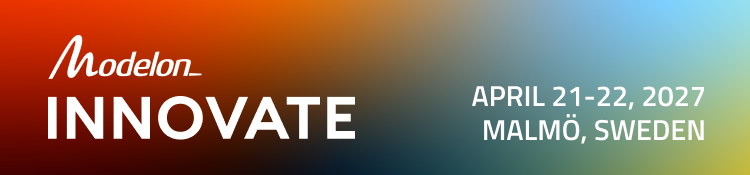



    



# Modelica Association Newsletter 2026-03

issued on <!-- TODO: issue date -->





    <i class="fa-regular fa-envelope" style="font-size:50px"></i>



## Letter from the Board

<!-- TODO: Letter from the Board -->



    <i class="fa-solid fa-building-columns" style="font-size:50px"></i>



## Modelica Association

<!-- TODO: news from the Modelica Association and its projects (FMI, SSP, DCP, eFMI, ...) -->

<!-- END Modelica Association -->



    <i class="fa-solid fa-users" style="font-size:50px"></i>



## Conferences and user meetings

<!-- TODO: Conferences and user meetings -->
### Modelon Innovate 2027

**Physics-Driven. Agent-Powered.**\
**April 21-22, 2027 | Clarion Malmö Live | Malmö, Sweden**

Modelon Innovate brings together Modelon customers, partners, and industry experts for two in-person days of insight, education, and connection.

The event agenda is now taking shape, with [keynote speakers and featured sessions](https://www.modelon.com/https://www.modelon.com/innovate-2027/speakers/) starting to be announced. Attendees can look forward to customer success stories, industry-focused presentations, partner perspectives, product updates, and discussions exploring the future of simulation and AI-enabled engineering.

Participants will also gain practical knowledge through hands-on training led by Modelon experts, with sessions focused on Modelon Impact workflows, Modelica-based skills, troubleshooting, and applying new capabilities to real-world engineering challenges.

Explore the growing agenda and secure your spot on the [Modelon Innovate website.](https://www.modelon.com/innovate-2027/) 

*This article is provided by Lauren Caris at Modelon.*

<!-- END Conferences and user meetings -->



    <i class="fa-solid fa-industry" style="font-size:50px"></i>



## Vendor news

<!-- TODO: Vendor news -->

<!-- END Vendor news -->



    <i class="fa-solid fa-book" style="font-size:50px"></i>



## News from libraries

<!-- TODO: News from libraries -->

<!-- END News from libraries -->



    <i class="fa-solid fa-graduation-cap" style="font-size:50px"></i>



## Education news

<!-- TODO: Education news -->

<!-- END Education news -->
