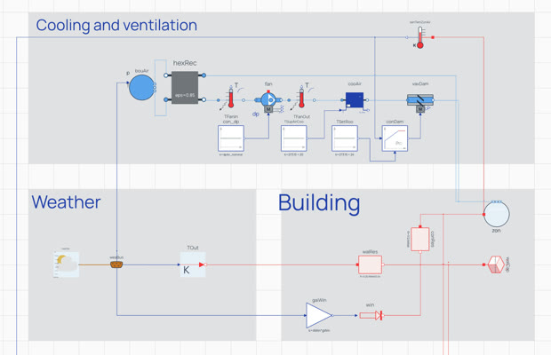
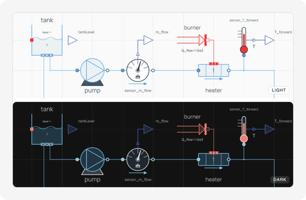
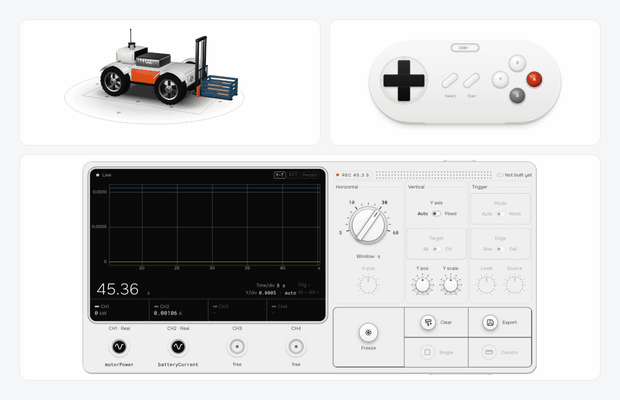
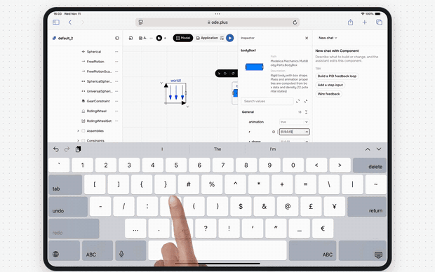



    



# Modelica Association Newsletter 2026-03

issued on <!-- TODO: issue date -->





    <i class="fa-regular fa-envelope" style="font-size:50px"></i>



## Letter from the Board

<!-- TODO: Letter from the Board -->



    <i class="fa-solid fa-building-columns" style="font-size:50px"></i>



## Modelica Association

<!-- TODO: news from the Modelica Association and its projects (FMI, SSP, DCP, eFMI, ...) -->

<!-- END Modelica Association -->



    <i class="fa-solid fa-users" style="font-size:50px"></i>



## Conferences and user meetings

<!-- TODO: Conferences and user meetings -->

<!-- END Conferences and user meetings -->



    <i class="fa-solid fa-industry" style="font-size:50px"></i>



## Vendor news

<!-- TODO: Vendor news -->

### [ODE+](https://www.ode.plus): Buildings Library 14 in the browser, a new look for the MSL and interactive simulation in beta

In addition to the features described in the [previous issue](https://modelica.org/newsletter/2026-02/), [ODE+](https://www.ode.plus) Component has added the following since August. Details and short videos are in the [ODE+ changelog](https://www.ode.plus/en/changelog).

#### Buildings Library 14, compiled in the browser

Models that call external C functions are now compiled to WebAssembly and simulated in the browser, with the library's C sources built next to the model. 556 of the 614 examples of the Buildings Library 14.0.0 (91%, up from 69% with Buildings 13) and 211 of the 216 examples of ThermofluidStream 1.4.1 run on the user's own machine, without waiting for a server. Weather files and CSV output are handled in the browser; models coupled to EnergyPlus, Python, FFD or BCVTB still run on the server.





#### A new design system for the MSL icons

The Modelica Standard Library icons were drawn over many years by many authors, without a shared color design. ODE+ now offers an optional redesign: one color system with consistent saturation across physical domains, the hues users already know, and a light and a dark variant of every color, so large diagrams stay readable in both modes. 107 fluid and thermal icons were redrawn in the same style. Only the display changes; the Modelica code is not modified, and the original look is one setting away.





#### Modelica simulation goes live

Besides a single run, ODE+ now runs a model many times for a parameter study. A parameter sweep shows every run in one chart, and MultiBody results replay in 3D next to their charts on one shared timeline.

Interactive simulation is in closed beta and coming soon to all users. Modelica models are compiled to a WebAssembly FMU and run live in the browser, paused and resumed, and parameters can be tuned while the model runs. Knobs, sliders, gauges, lamps and a four-channel scope on the diagram are linked to model variables and respond during the run, and they can be operated by touch, keyboard or a gamepad.





#### Custom 2D interactive instruments from Figma

Also part of the closed beta, the ODE+ Figma plugin turns a control or display drawn in Figma into a live instrument. The plugin checks the design, names its moving parts and ports, and sends it to the user's ODE+ account, where it is linked to model variables like a built-in instrument.





#### Endless 3D assets for interactive simulation, from the community and your own CAD

In the same beta, a 3D Model instrument imports public Onshape assemblies and robots from MuJoCo Menagerie and ROS packages (URDF, xacro), or the user's own CAD exported as glTF, OpenUSD or URDF. Each part is linked to a model variable, so the imported model moves with the simulation. Built-in 3D devices such as pumps, valves, tanks, motors and heat exchangers show the state of a plant model.





#### Working together

A task is shared with a link. In a shared task, team members can follow each other live and see the other person's cursor and edits. Comments are pinned to the diagram, with mentions and replies, and resolved when done.





#### AI copilot and MCP server

The assistant in the side panel reads the open model and answers questions about it, builds or changes a model from a description, and can be asked to fix a failed run from its result card. The generated Modelica code stays visible and editable.





The ODE+ MCP server, which lets external AI clients use ODE+, has been renewed. Clients now sign in with OAuth instead of a token in the URL, connect over Streamable HTTP as well as SSE, and get a closed loop of tools: create and list tasks, write and read a model, check it, simulate it with parameter overrides, read the run's results, and open the task in ODE+. Setup instructions for Claude, Codex, Cursor and other clients are in the [ODE Modelica MCP Server repository](https://github.com/Orthogonalpub/modelica_simulation_mcp_server).

#### iPad and touch

The whole workflow, from building a model to reading its results, works on an iPad with a finger or Apple Pencil and without a keyboard. Touch targets follow Apple's Human Interface Guidelines, and a magnifier under the finger makes small ports easy to hit.





#### Four languages

The interface is available in English, Chinese, German and Japanese and switches without reloading the page.





#### Free for teaching

Teachers and students at universities worldwide can use ODE+ free of charge during their courses. In the winter semester 2026/27, the Technical University of Munich (TUM) is again using ODE+ in its Modelica teaching.

#### Coming next

A Team plan for organizations, building on the team spaces described in the previous issue.





Questions and feedback are welcome at [contact@ode.plus](mailto:contact@ode.plus).

*This article is provided by Dr. Yang Ji ([orthogonal GmbH](https://www.ode.plus))*

<!-- END Vendor news -->



    <i class="fa-solid fa-book" style="font-size:50px"></i>



## News from libraries

<!-- TODO: News from libraries -->

<!-- END News from libraries -->



    <i class="fa-solid fa-graduation-cap" style="font-size:50px"></i>



## Education news

<!-- TODO: Education news -->

<!-- END Education news -->
