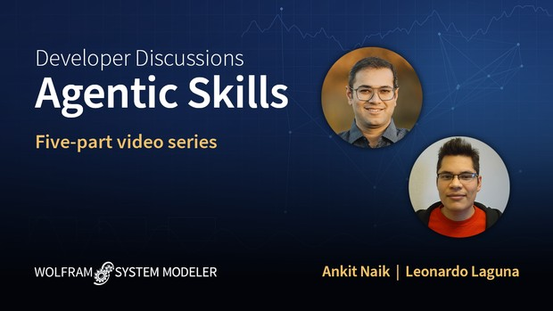



    



# Modelica Association Newsletter 2026-03

issued on <!-- TODO: issue date -->





    <i class="fa-regular fa-envelope" style="font-size:50px"></i>



## Letter from the Board

<!-- TODO: Letter from the Board -->



    <i class="fa-solid fa-building-columns" style="font-size:50px"></i>



## Modelica Association

<!-- TODO: news from the Modelica Association and its projects (FMI, SSP, DCP, eFMI, ...) -->

<!-- END Modelica Association -->



    <i class="fa-solid fa-users" style="font-size:50px"></i>



## Conferences and user meetings

<!-- TODO: Conferences and user meetings -->

<!-- END Conferences and user meetings -->



    <i class="fa-solid fa-industry" style="font-size:50px"></i>



## Vendor news

<!-- TODO: Vendor news -->

### Wolfram System Modeler: Video Series on Agentic Skills

[Wolfram System Modeler](https://www.wolfram.com/system-modeler/) provides a set of agent skills that let AI coding assistants such as Claude Code or Codex create, validate, simulate, diagnose and document Modelica models.

The skills use the System Modeler kernel for compilation and simulation, and results can be analyzed in the Wolfram Language through the Wolfram MCP server. The skills are released under the MIT license on [GitHub](https://github.com/WolframResearch/system-modeler-ai-toolkit).

In the video series [Developer Discussions: Agentic Skills](https://www.youtube.com/playlist?list=PLDoLu2s-YHDY), System Modeler developers Ankit Naik and Leonardo Laguna Ruiz use the skills on live problems:

1. [Building models](https://www.youtube.com/watch?v=wXld8l1mdIg&list=PLDoLu2s-YHDY): a Chua circuit, a five-link pendulum, a thermosiphon and a Hoberman mechanism
2. [Analyzing models](https://www.youtube.com/watch?v=7eHo4IM1q3o&list=PLDoLu2s-YHDY): linearization and LQR control of a gyroscopic monorail
3. [Connecting models to real-world applications](https://www.youtube.com/watch?v=eKq9EdMeBgs&list=PLDoLu2s-YHDY): Arduino sensors, OPC UA and CAN
4. [Debugging slow models](https://www.youtube.com/watch?v=UR0YabxpYJQ&list=PLDoLu2s-YHDY)
5. [Sharing models through FMI](https://www.youtube.com/watch?v=O78MzUSZeVA&list=PLDoLu2s-YHDY)

Try the skills with a [free 30-day trial of Wolfram System Modeler](https://www.wolfram.com/system-modeler/trial/), and follow [System Modeler on LinkedIn](https://www.linkedin.com/showcase/wolfram-systemmodeler/) for news.

*This article is provided by Ankit Naik ([Wolfram Research](https://www.wolfram.com/system-modeler/))*

<!-- END Vendor news -->



    <i class="fa-solid fa-book" style="font-size:50px"></i>



## News from libraries

<!-- TODO: News from libraries -->

<!-- END News from libraries -->



    <i class="fa-solid fa-graduation-cap" style="font-size:50px"></i>



## Education news

<!-- TODO: Education news -->

<!-- END Education news -->
