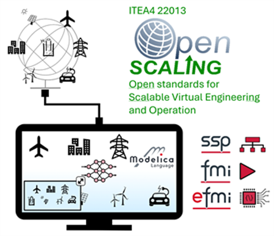



    



# Modelica Association Newsletter 2026-03

issued on <!-- TODO: issue date -->





    <i class="fa-regular fa-envelope" style="font-size:50px"></i>



## Letter from the Board

<!-- TODO: Letter from the Board -->



    <i class="fa-solid fa-building-columns" style="font-size:50px"></i>



## Modelica Association

<!-- TODO: news from the Modelica Association and its projects (FMI, SSP, DCP, eFMI, ...) -->
### OpenSCALING - Breakthrough Innovations for Modelica, FMI, SSP, eFMI

[ITEA project OpenSCALING](https://openscaling.org/) impressed the reviewers with break-through innovations and broad tool support for enhanced MA standards.

On 12 November 2026, the OpenSCALING consortium presented its project outcomes at the final ITEA review. Ten industrial applications from the energy, aviation, automotive and buildings sectors illustrated the key achievements of the work packages: large-scale system modelling, PeNODEs (physics-enhanced neural ODEs), uncertainty quantification and credible workflows. Breakthrough innovations in the translation of Modelica models include keeping the translation effort independent of array size and allowing arrays to be resized after translation. This drastically reduces translation time, raises the feasible model size by orders of magnitude in the number of states and equations, and makes FMI models more flexible. Tool improvements can be assessed with the published [benchmark models](https://gitlab.liu.se/openscaling/work-products/d3.2-open-source-benchmark-models-for_lss). In addition, PeNODEs achieved simulation speed-ups of 12–820 times. New browser-based Modelica tools enable responsive web applications for flexible system configuration, sizing and evaluation, with Modelica models simulated in the background.

The project proposes LS-VVUQ, a draft layered standard for [Verification, Validation and Uncertainty Quantification](https://d2-1-uq-layered-standard-39ee06.gitlab-pages.liu.se) that applies to FMI, SSP and the Modelica language. One industrial demonstration is a driver-in-the-loop truck simulator which uses the credibility metadata carried with the models to assess how trustworthy its real-time simulations are. Commercial and open-source tools already support LS-VVUQ and its integration into the credible simulation process.

*This article is provided by Oliver Lenord (OpenSCALING project leader)*
<!-- END Modelica Association -->



    <i class="fa-solid fa-users" style="font-size:50px"></i>



## Conferences and user meetings

<!-- TODO: Conferences and user meetings -->

<!-- END Conferences and user meetings -->



    <i class="fa-solid fa-industry" style="font-size:50px"></i>



## Vendor news

<!-- TODO: Vendor news -->

<!-- END Vendor news -->



    <i class="fa-solid fa-book" style="font-size:50px"></i>



## News from libraries

<!-- TODO: News from libraries -->

<!-- END News from libraries -->



    <i class="fa-solid fa-graduation-cap" style="font-size:50px"></i>



## Education news

<!-- TODO: Education news -->

<!-- END Education news -->
