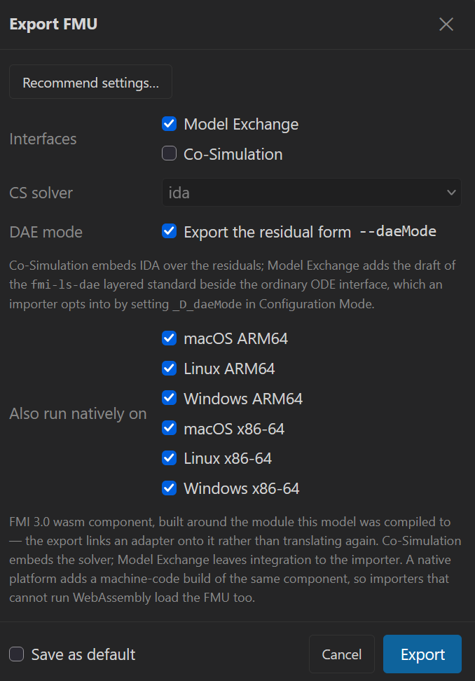



    



# Modelica Association Newsletter 2026-03

issued on <!-- TODO: issue date -->





    <i class="fa-regular fa-envelope" style="font-size:50px"></i>



## Letter from the Board

<!-- TODO: Letter from the Board -->



    <i class="fa-solid fa-building-columns" style="font-size:50px"></i>



## Modelica Association

<!-- TODO: news from the Modelica Association and its projects (FMI, SSP, DCP, eFMI, ...) -->

<!-- END Modelica Association -->



    <i class="fa-solid fa-users" style="font-size:50px"></i>



## Conferences and user meetings

<!-- TODO: Conferences and user meetings -->

<!-- END Conferences and user meetings -->



    <i class="fa-solid fa-industry" style="font-size:50px"></i>



## Vendor news

<!-- TODO: Vendor news -->

### OpenModelica 1.28.0 in Preparation

The next [OpenModelica](https://openmodelica.org/) release, 1.28.0, is in preparation. Its highlights:

* **OpenModelica in the web browser** with nothing to install: OMEdit (with an optional AI assistant), OMShell, OMNotebook, OMPlot and a simulator with 3D animation, all compiled to WebAssembly and run locally in the browser.
* **FMI 3.0 export and import**: OpenModelica exports FMI 3.0 FMUs for Model Exchange and Co-Simulation, and OpenModelica and OMSimulator import them.
* **Modelica 3.7** support in the frontend (`--std=3.7`), for example unitful literals and `nthRoot`.
* **OMEdit**: Figure and Plot annotations, an array parameter editor, dark mode, UML class diagrams and Modelica Language Server integration.
* **Simulation**: the solver is now chosen automatically by default (`-s=auto`), with CVODE replacing DASSL as its choice for most models, simulations free their memory through reference counting instead of a garbage collector, and the new backend supports resizable arrays.

OpenModelica developers take part in the FMI-LS-DAE and FMI-LS-WASM working groups, and 1.28.0 contains first prototypes of both layered standards. Models in DAE mode can be exported following the FMI-LS-DAE v1.0.0-alpha.1 draft, and OMSimulator can import them. FMUs can also be exported with a WebAssembly binary, optionally alongside native binaries for Linux, macOS and Windows, following the early FMI-LS-WASM draft, which is still being worked on and may change without notice.

You can try this now on the [OpenModelica web playground](https://playground.openmodelica.org/demo/). For example, open the [district heating example in DAE mode](https://playground.openmodelica.org/demo/simulator/index.html?id=districtheating), simulate it and export it as an FMU.



<em>FMU export dialog of the OpenModelica web playground with FMI-LS-DAE and FMI-LS-WASM export</em>



*This article is provided by Andreas Heuermann for the [OpenModelica](https://openmodelica.org/) project*

<!-- END Vendor news -->



    <i class="fa-solid fa-book" style="font-size:50px"></i>



## News from libraries

<!-- TODO: News from libraries -->

<!-- END News from libraries -->



    <i class="fa-solid fa-graduation-cap" style="font-size:50px"></i>



## Education news

<!-- TODO: Education news -->

<!-- END Education news -->
