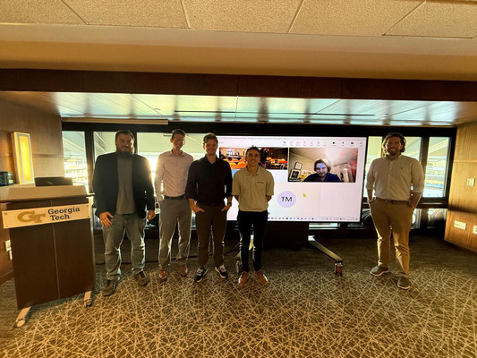



    



# Modelica Association Newsletter 2026-03

issued on <!-- TODO: issue date -->





    <i class="fa-regular fa-envelope" style="font-size:50px"></i>



## Letter from the Board

<!-- TODO: Letter from the Board -->



    <i class="fa-solid fa-building-columns" style="font-size:50px"></i>



## Modelica Association

<!-- TODO: news from the Modelica Association and its projects (FMI, SSP, DCP, eFMI, ...) -->

<!-- END Modelica Association -->



    <i class="fa-solid fa-users" style="font-size:50px"></i>



## Conferences and user meetings

<!-- TODO: Conferences and user meetings -->

### American Modelica & FMI Conference 2026: a report from Atlanta

*Participants of the OpenModelica Workshop.*

The **American Modelica & FMI Conference 2026** brought our community together at Georgia Tech in Atlanta on October 12–14. Organized by NAMUG with the Modelica Association, it featured six workshops, two keynotes, 27 paper presentations, and eight industrial presentations.

The conference featured two keynotes. In the first, Oliver Lenord (Bosch) explored how open standards enable larger, faster, and more credible simulations. The second keynote, by Daniel Mikkelson (Idaho National Laboratory), addressed nuclear-system modeling for integrated energy systems. Technical sessions ranged from FMI and emerging tools to buildings, power systems, automotive applications, and data centers. A new track broadened the discussion to equation-oriented languages beyond Modelica.

Congratulations to Elmir Nahodovic and coauthors for the Best Paper, “Towards an FMI Layered Standard for DAE,” and to Md Nazmul Hassan Chowdhury and Luigi Vanfretti for the Best Student Paper, “MMChvdcLibrary.”

Thank you to our hosts, presenters, workshop organizers, reviewers, and sponsors. [Presentation slides](/events/american2026/presentations/) and [conference highlights and photos](american2026-recap/) are available. Final proceedings will be published by Linköping University Electronic Press.

*This article is provided by Luigi Vanfretti ([Rensselaer Polytechnic Institute](https://www.rpi.edu/)).*

<!-- END Conferences and user meetings -->



    <i class="fa-solid fa-industry" style="font-size:50px"></i>



## Vendor news

<!-- TODO: Vendor news -->

<!-- END Vendor news -->



    <i class="fa-solid fa-book" style="font-size:50px"></i>



## News from libraries

<!-- TODO: News from libraries -->

<!-- END News from libraries -->



    <i class="fa-solid fa-graduation-cap" style="font-size:50px"></i>



## Education news

<!-- TODO: Education news -->

<!-- END Education news -->
