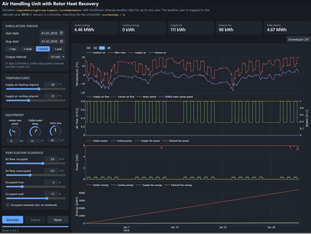



    



# Modelica Association Newsletter 2026-03

issued on <!-- TODO: issue date -->





    <i class="fa-regular fa-envelope" style="font-size:50px"></i>



## Letter from the Board

<!-- TODO: Letter from the Board -->



    <i class="fa-solid fa-building-columns" style="font-size:50px"></i>



## Modelica Association

<!-- TODO: news from the Modelica Association and its projects (FMI, SSP, DCP, eFMI, ...) -->

<!-- END Modelica Association -->



    <i class="fa-solid fa-users" style="font-size:50px"></i>



## Conferences and user meetings

<!-- TODO: Conferences and user meetings -->

<!-- END Conferences and user meetings -->



    <i class="fa-solid fa-industry" style="font-size:50px"></i>



## Vendor news

<!-- TODO: Vendor news -->
### Modiator for responsive web apps

[Modiator](https://modiator.com) (Modelica Instant Simulator) is now listed under [Modelica Tools](https://modelica.org/tools/). It is a progressive web app, so it runs in the browser, works offline and requires no installation or registration. Its responsive, touch-friendly interface lets you model, adjust parameters with sliders, simulate, view plots and animate on any device, including *smartphones* and *tablets*. A new [YouTube channel](https://www.youtube.com/@ModelicaandModiator) shows in short video clips how small real-world experiments are modeled and simulated. These features make Modiator well suited for university teaching, as in the [Simulation of Mechatronic Systems](https://www.epe.ed.tum.de/ewt/lehre/bscei/simulation-mechatronischer-systeme/) course at the Technical University of Munich.

In the [ITEA OpenSCALING](https://openscaling.org/) research project, Modiator served as the simulation engine for a responsive Swegon web app. The app demonstrated how variants of air handling units can be configured and their key performance indicators obtained quickly from background simulations. The Swegon web app generates Modelica models on the fly and sends them to Modiator, which translates and simulates them and returns the results. This offers much greater flexibility than pre-defined FMI models, including with regard to causality. For a flavor of the possibilities, take a look at the Modiator demos [HVACairHandlingUnit](https://modiator.com/webapps/hvacairhandlingunit/) and [CraneCrab3D](https://modiator.com/examples/cranecrab3d/), which were generated with the help of AI directly from the underlying Modelica models.

*This article is provided by [Hilding Elmqvist](mailto:hilding.elmqvist@mogram.net) and [Martin Otter](mailto:martin.otter@dlr.de).*
<!-- END Vendor news -->



    <i class="fa-solid fa-book" style="font-size:50px"></i>



## News from libraries

<!-- TODO: News from libraries -->

<!-- END News from libraries -->



    <i class="fa-solid fa-graduation-cap" style="font-size:50px"></i>



## Education news

<!-- TODO: Education news -->

<!-- END Education news -->
