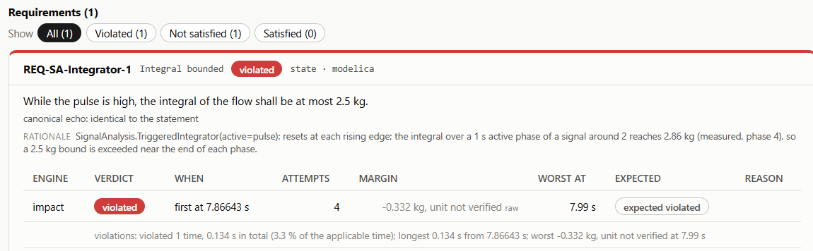
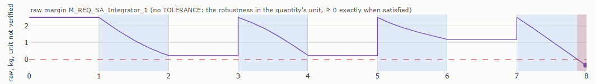
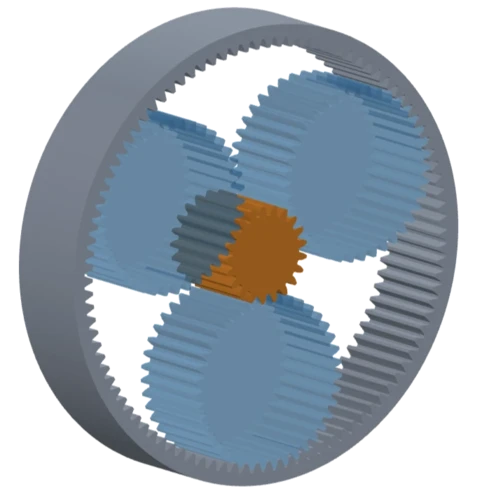
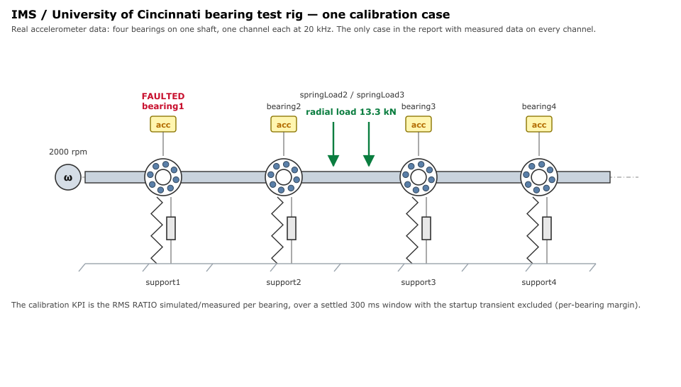



    



# Modelica Association Newsletter 2026-03

issued on <!-- TODO: issue date -->





    <i class="fa-regular fa-envelope" style="font-size:50px"></i>



## Letter from the Board

<!-- TODO: Letter from the Board -->



    <i class="fa-solid fa-building-columns" style="font-size:50px"></i>



## Modelica Association

<!-- TODO: news from the Modelica Association and its projects (FMI, SSP, DCP, eFMI, ...) -->

<!-- END Modelica Association -->



    <i class="fa-solid fa-users" style="font-size:50px"></i>



## Conferences and user meetings

<!-- TODO: Conferences and user meetings -->

<!-- END Conferences and user meetings -->



    <i class="fa-solid fa-industry" style="font-size:50px"></i>



## Vendor news

<!-- TODO: Vendor news -->
### Model Based Innovation (MBI) Updates

#### Modelica Requirements library redesigned and released

The Modelica Requirements library has been redesigned and is now public on github: [Requirements](https://github.com/MBILLC/Requirements/).
The library allows to execute requirements as Modelica- or FMI models and verify whether requirements are fullfilled, manually or in a fullyautomated manner. 

In its predecessor, Modelica_Requirements, each requirement was a hand-written model simulated together with the plant. This had three drawbacks: 
the checks slowed the solver on complex models (up to 9x in our measurements), events in the requirement models could slightly change the plant 
results, and a requirement that was never exercised during a run gave no diagnostic saying so.

##### The Main Changes and Improvements

- **Two runs, one file:** the plant is simulated by itself, its signals are stored as a Modelica-Association standardized [CSV file](https://github.com/modelica/ma-hs-csv), and 
  the generated check models read that file. Any Modelica, FMI or SSP tool can be the source tool for the plant simulation. The plant is no longer perturbed by the checks.
- **Four-valued logic inside, three-valued verdicts outside:** violated, untested (with a reason), satisfied, or undefined. This implements the design principles from the CRML language
  designed in the ITEA EMBrACE EU project. 
- **A margin on every check,** in units of the requirement's tolerance, so "barely satisfied" is no longer the same as "satisfied with room to spare". 
  The margin shows how far, and in which direction, the design must change.
- **New checks:** step-response metrics, eigenvalue checks over a linearization, steady-state requirements and violation statistics for long runs.
- **Every example builds and simulates** in Modelon Impact, Dymola, and OpenModelica.
- **Validation reports:** Detailed validation reports are built as html-websites or linked Jupyter notebooks.  
  Runs can be compared against a baseline, with changes highlighted, so requirements validation fits into CI/CD workflows.  

##### Why Now?

Agentic AI makes it practical to connect requirements and simulation far more tightly. MBI is developing a toolchain that links systems engineering artifacts 
(requirements in natural language or SysMLv2) with Modelica models. The agent connects model variables to requirement terms and checks that the vocabulary and used terms are 
fully covered by the written rules. To test the complete toolchain, request a demo and evaluation at hubertus.tummescheit@modelbased.cloud.

##### What else is new?

[StrictDoc](https://github.com/strictdoc-project/strictdoc) is a Python-based open-source tool for technical documentation and requirements management. It is 
very useful for teams that need to work with requirements without being tied to a traditional requirements management tool. It can also be used in combination 
with requirements management tools via import and export of ReqIF. It now has full support for Modelica classes and components, developed by MBI. This opens new possibilities for the better 
integration of requirements and Model Based Design with Modelica, FMI and SSP. Requirements and their unique IDs can be linked to classes, components and arbitrary code sections. 

##### License and compatibility

It remains a derivative of Modelica_Requirements 0.7.1 under the BSD 3-Clause license. Almost all models from the 0.7.1 release still run unchanged, however, conformance to 
the Modelica specification is improved, as well as tool compatibility. 

The README explains the reasoning behind the redesign. Feedback and issues are welcome. 

#### New RotorDynamics Library available

RotorDynamics models rotating machinery as shaft lines: rotors with lateral (transverse)
flexibility, gyroscopic coupling and torsional compliance, carried on rolling, plain and
hydrodynamic bearings in elastic housings, and coupled through gear meshes of every common
family: spur and helical (external and internal), double-helical, rack and pinion, straight and
spiral bevel, hypoid, crossed-helical and worm. A complete planetary stage, with a rigid or flexible
ring, is one component. The excitations a condition-monitoring study needs are part of the library:
rotor unbalance, rolling-bearing faults, gear tooth damage, mesh-stiffness variation, transmission error and
coupling misalignment. Friction and losses are included, with lubricated tooth friction available
from the oil's viscosity. Any model can be viewed in 3-D, gears included. 

The library models rotating machinery for fault detection and diagnosis. It includes the typical fault conditions of every component 
it contains. The models are deliberately simpler than a full multibody model that resolves each bearing ball: this reduces the computational
effort by at least an order of magnitude without any disadvantage for diagnostics. 

It was developed following the Credible Simulation Process, which originated in the SET Level project and is now maintained and extended in the prostep ivip SmartSE project. 
Every physical phenomenon in the library has been validated, and the validation evidence ships with the library. The bearing and planetary gear 
fault models are validated against publicly available measurement data. Most other models are validated against the canonical German reference
for gear design (Niemann/Winter Maschinenelemente, volumes 2 and 3). 

Because the evidence is part of the library, AI agents can read the evidence and deduce permitted usages from it, which makes it easy to apply the library to realistic industrial problems. 
Matching agent skills and Credible Simulation Process tools are included and reduce the time and effort for verifying and validating your own models.
Development and thorough testing were done in Modelon Impact. All simulations also run in other Modelica tools; 
only the 3-D visualization requires Modelon Impact custom functions.

More details about the library can be found on [MBI's website](https://modelbased.cloud/libraries/rotordynamics/) 

<!-- END Vendor news -->



    <i class="fa-solid fa-book" style="font-size:50px"></i>



## News from libraries

<!-- TODO: News from libraries -->

<!-- END News from libraries -->



    <i class="fa-solid fa-graduation-cap" style="font-size:50px"></i>



## Education news

<!-- TODO: Education news -->

<!-- END Education news -->
